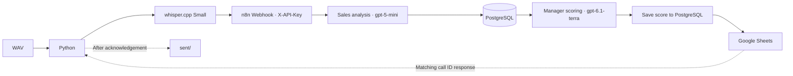
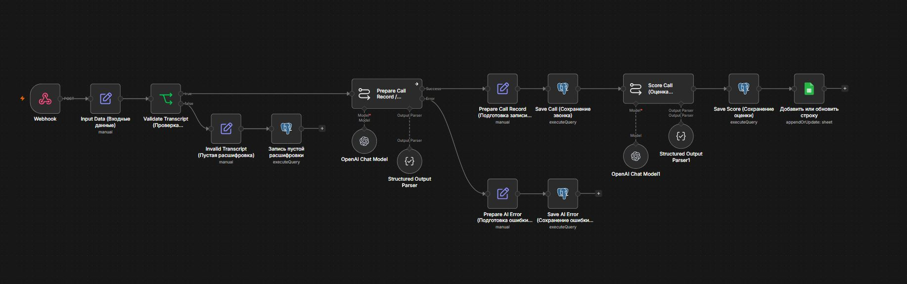
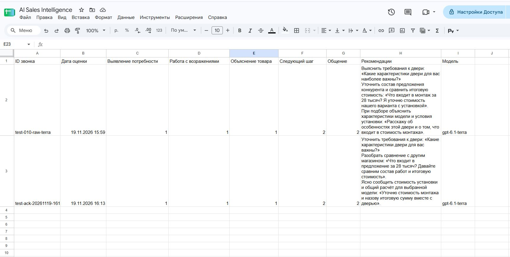

[English](README.md) | [Русский](README.ru.md)

# AI Sales Intelligence Platform

A sales call processing demo: local WAV transcription, structured sales analysis, manager scoring, PostgreSQL storage, and a Google Sheets report. Built with Python, whisper.cpp Small, and n8n.

## Demo

https://github.com/user-attachments/assets/0c4a3ef4-efe1-4f43-b6c0-968d9a342d16

64-second overview of completed call processing: the n8n workflow, extracted customer needs, and manager scoring. The interface and captions are in Russian.

The n8n results use `call_id=demo-002`. The Google Sheets segment is an example report from a separate test run, `demo-001`, explicitly labeled in the video.

## Business Problem

Call recordings require manual review to recover customer needs, budgets, objections, and agreed actions. Reviewing the manager's work is a separate task. This project stores the transcript, extracted facts, and an explained assessment under one unique `call_id`, with a compact report for review.

## How It Works

1. Python processes the `*.wav` files currently in `incoming/`, one at a time.
2. Local `whisper-cli.exe` uses multilingual Small (`ggml-small.bin`), Russian recognition (`-l ru`), TXT output (`-otxt`), and CPU execution (`-ng`).
3. Python sends `call_id` (the filename stem) and `transcript` to an n8n HTTPS Webhook with an `X-API-Key` header.
4. n8n checks for a nonempty transcript. `gpt-5-mini` extracts sales facts through a structured output parser, and PostgreSQL inserts or updates the call.
5. `gpt-6.1-terra` scores the original transcript through a second structured output parser. PostgreSQL saves the assessment before Google Sheets appends or updates a row matched by `ID звонка`.
6. The Webhook responds after the last node. Python waits for the HTTP response with a 180-second timeout and checks that it is a JSON object whose `ID звонка` equals the filename stem. Only then does it move the WAV and generated `.wav.txt` into `sent/`.

### Architecture



The Python script orchestrates transcription and sends text; audio stays local. Transcript text goes to n8n and the configured model provider. PostgreSQL is the record store. Google Sheets is a demonstration register, not a full CRM.

### Analysis and Scoring

The analysis contains `customer_need`, `budget_min`, `budget_max`, `purchase_timeline`, `objections`, `next_action`, and `deal_status` (`interested`, `not_interested`, or `unknown`). Missing facts are requested as `null`.

| Criterion | What is assessed |
| --- | --- |
| `need_discovery` | Discovery of requirements, budget, and timing |
| `objection_handling` | Clarification of concerns and a relevant response |
| `product_knowledge` | Completeness and clarity of product and purchase explanations |
| `next_step` | Agreement on the next action |
| `communication` | Clarity and politeness visible in the text |

Each criterion is `0` (not done), `1` (partial), `2` (done well), or `null` (insufficient evidence). The prompt requests a short explanation with a transcript quote in each corresponding `*_reason` field and up to three conversation-specific recommendations with example wording. Reasons are nullable in the parser schema. Unclear speaker roles should produce `null`; the workflow does not perform speaker diarization. It does not assess intonation or verify product claims against a company knowledge base.

PostgreSQL stores `transcript`, `analysis`, `status`, `score`, `score_model`, and `scored_at`, with a unique `call_id` and an internal `id`. Reasons and recommendations live inside the `score` JSONB object. A successful score save leaves `status = 'analyzed'`; status alone does not confirm scoring or Sheets delivery. Sheets receives the five scores, recommendations, scoring date, and model, but not the `*_reason` fields. `null` scores display as `Не оценено`; dates use `Europe/Moscow`.

## Workflow Screenshots

Real screenshots supplied with this project. They show the existing demonstration, not a fresh installation of the cleaned template.

### n8n Process



The main path saves analysis, scores the call, saves the score, and updates Sheets. Separate branches handle an empty transcript and a main-analysis error. Their presence is not evidence that all failure cases have been tested.

### Google Sheets Report



The register contains a call ID, scoring date, five scores, recommendations, and the model identifier. The screenshots are included as supplied.

## Example

All files in `examples/` are manually prepared synthetic fixtures without personal data. They illustrate the contract and are not captured model responses or evidence of another successful run.

| File | Content |
| --- | --- |
| [request.json](examples/request.json) | Webhook body with a Russian transcript without manual speaker labels |
| [result.json](examples/result.json) | Illustrative complete `public.calls` row, including analysis and explained scores |
| [webhook-response.json](examples/webhook-response.json) | Illustrative final Sheets output / HTTP acknowledgement object |

Input: a customer needs an apartment entrance door, has a budget up to 40,000, and wants to buy within two weeks. They compare an offer including installation with the manager's offer excluding installation. The illustrative analysis retains the budget ceiling and the agreed proposal for today. The example scores are `1 / 1 / 1 / 2 / 2`, with recommendations about requirements, offer comparison, and the promised proposal. Actual AI output can differ.

The database row is not the HTTP response. Python requires the response object's Russian `ID звонка` key to match `demo-synthetic-001`. The sample response preserves the template's current literal `\n` recommendation separator.

## Verified Scenarios

These are the scenarios reported as confirmed in the existing demonstration. They were not rerun during repository preparation.

| Scenario | Confirmed result |
| --- | --- |
| Full chain starting with a WAV file | Transcription, analysis, scoring, PostgreSQL, and Sheets completed |
| Original transcript without manual speaker labels | Analysis and manager assessment completed |
| Score persistence | Scores, reasons, and recommendations were saved |
| Repeated `call_id` | Existing database record and Sheets row were updated |
| Python acknowledgement | Matching `ID звонка` was received; files moved into `sent/` |

Stable accuracy across different conversations and all failure scenarios are **not verified**. SQL to clear an old score when transcript text changes is present, but that behavior has not had a separate test. Importing the cleaned template into a fresh n8n installation has not been verified.

## Installation and Run

### 1. Local Files

Use Windows with Python 3, a running n8n instance with the node versions used by the template, PostgreSQL, model-provider access to both configured model IDs, and a Google account with edit access to the report spreadsheet. Exact n8n and whisper.cpp versions used in the demonstration were not recorded. Python uses only the standard library; no `pip install` step is required.

From the project root in PowerShell, create the working directories. Copy the configuration example only for a new checkout; the conditional preserves an existing `.env`:

```powershell
New-Item -ItemType Directory -Force -Path incoming, sent | Out-Null
if (-not (Test-Path -LiteralPath .env)) {
    Copy-Item -LiteralPath .env.example -Destination .env
}
```

Replace the placeholder locally with the same secret configured in n8n. The current script expects exactly one unquoted line, without comments or extra variables:

```dotenv
WEBHOOK_API_KEY=replace_with_your_webhook_key
```

This is the Webhook shared secret, not a model-provider API key. Provider, database, and Google credentials belong in n8n credentials. The script reads everything after the first `=`; it is not a general dotenv parser.

Obtain a suitable Windows build from the [official whisper.cpp releases](https://github.com/ggml-org/whisper.cpp/releases) and the multilingual `small` model using the [official model instructions](https://github.com/ggml-org/whisper.cpp/tree/master/models). Place `whisper-cli.exe`, **all DLLs supplied with that build**, and `ggml-small.bin` directly in `Release/`, alongside [transcribe.py](Release/transcribe.py). Do not substitute the English-only `small.en` model. These local dependencies are excluded from Git.

```text
AI-Sales/
  .env                       # local only
  Release/
    transcribe.py
    whisper-cli.exe          # local only
    whisper.dll              # local only; DLL set varies by build
    ... other supplied DLLs  # local only
    ggml-small.bin           # local only
  incoming/                  # local WAV input
  sent/                      # acknowledged WAV + .wav.txt
```

Use 16-bit PCM WAV input; mono 16 kHz is the conversion example in the [whisper.cpp quick start](https://github.com/ggml-org/whisper.cpp#quick-start). Audio conversion is not part of this script. Choose a distinct filename for each new call; reusing a filename reuses its `call_id`.

### 2. PostgreSQL

Create a database and a database user, then run [001_create_calls.sql](sql/001_create_calls.sql) in that database, for example:

```powershell
psql -h localhost -p 5432 -U ai_sales_user -d ai_sales -f sql/001_create_calls.sql
```

The role running this creation script needs permission to create the table. The n8n role needs schema access, `SELECT`, `INSERT`, and `UPDATE` on `public.calls`, and access to its identity sequence. Running creation as the same owning role supplies those object permissions. Existing tables require a separate schema comparison; `IF NOT EXISTS` does not add missing columns. Ensure `public` is in the connection's `search_path`, as the error branches use unqualified `calls`.

### 3. n8n Connections

Import [ai-sales-intelligence.template.json](workflows/ai-sales-intelligence.template.json). It is inactive, has empty pinned data, and contains no credential references. Reconnect these nodes before enabling the workflow:

| Connection | Configuration |
| --- | --- |
| `Webhook` | POST, path `ai-sales/transcript`, Header Auth credential: header name `X-API-Key`, value equal to the local `.env` secret |
| `OpenAI Chat Model` | Provider credential with access to `gpt-5-mini`; this is the main analysis model |
| `OpenAI Chat Model1` | Provider credential with access to `gpt-6.1-terra`; this is the manager scoring model |
| All five Postgres nodes | Same host, port, database, user, password, and appropriate TLS settings; includes the disconnected `Execute a SQL query` inspection node |
| `Добавить или обновить строку` | Google Sheets credential, your spreadsheet ID, and your actual worksheet |

The model IDs above are the values in the supplied workflow; availability depends on the connected provider/account. If either is unavailable, this exact configuration cannot run as documented. Configure credentials according to the official [Postgres](https://docs.n8n.io/integrations/builtin/credentials/postgres/) and [Webhook](https://docs.n8n.io/integrations/builtin/core-nodes/n8n-nodes-base.webhook/) documentation.

Keep the Webhook response mode **When Last Node Finishes** (`lastNode`) and **First Entry JSON**, so that the caller receives one object from the final Sheets node. An immediate acknowledgement or an array does not satisfy the Python check.

### 4. Google Sheets

Create a spreadsheet and a worksheet named `Звонки`. Put these exact headers in row 1, columns A through I:

```text
ID звонка | Дата оценки | Выявление потребности | Работа с возражениями | Объяснение товара | Следующий шаг | Общение | Рекомендации | Модель
```

Connect a Google Sheets OAuth2 credential in n8n with an account that can edit this spreadsheet. For a custom OAuth setup, enable Google Sheets API and Google Drive API, configure consent and an OAuth web client, copy the exact redirect URI shown in n8n, then complete sign-in. Follow the [official Google OAuth2 instructions](https://docs.n8n.io/integrations/builtin/credentials/google/oauth-single-service/).

In the Sheets node, replace `REPLACE_WITH_SPREADSHEET_ID` with your document ID, reselect the worksheet (do not assume its ID is `gid=0`), and refresh column metadata if needed. Keep **Append or Update Row**, mapping by **ID звонка**, and all nine field expressions from the template. Do not prepopulate duplicate IDs. Enable text wrapping for recommendations for readability.

### 5. Run Intentionally

In [transcribe.py](Release/transcribe.py), replace the existing fixed URL passed to `urllib.request.Request` with the **Production URL** of your own Webhook. The current `.env` has no URL setting. Publish/activate the workflow according to your n8n version and ensure its HTTP/proxy timeout allows the synchronous process to finish.

After all connections are configured, put an authorized test WAV into `incoming/` and run:

```powershell
python .\Release\transcribe.py
```

This command performs live processing and can incur model-provider charges. It was **not run** during repository preparation. For a text-only test in your own configured environment, use `examples/request.json` as the POST JSON body with `Content-Type: application/json` and `X-API-Key`; this bypasses transcription and file movement and also invokes the models.

## Limitations

- This is a demonstration workflow. No broad accuracy benchmark, guaranteed processing time, or exhaustive recovery test is available. Raw ASR text can contain wrong numbers, unclear roles, and missing details; review assessments before using them for staff decisions.
- Transcription runs locally, but transcript text is sent to n8n and model services. PostgreSQL and n8n execution history can contain call data. The published examples are synthetic; recordings, real transcripts, credentials, Whisper binaries, and models are excluded.
- The script is a single batch pass, not a folder watcher or service. Language, paths, model file, Webhook URL, and the 180-second HTTP timeout are fixed in the source. `.env` parsing supports only the single-line format above.
- Repeating `call_id` updates the database record and Sheets row but invokes analysis and scoring again. It is not a guarantee of exactly-once execution. PostgreSQL and Sheets updates are not one transaction; a timeout may occur after server-side work has completed.
- The analysis upsert clears `score`, `score_model`, and `scored_at` if the transcript changes; this SQL has no separate confirmed test. Score saving also checks that the stored transcript equals the scored text. Concurrent requests and synchronization of stale Sheets rows have not been verified.
- Empty-transcript and main-analysis-error branches exist. On conflict they only set `status = 'error'`, so older analysis or scores can remain. The AI-error path also depends on which fields reach it from the failed node. Scoring, database, and Sheets failures do not all have dedicated recovery paths.
- Python checks the response object and matching ID, not every saved field. A failed acknowledgement leaves files for inspection/retry in the usual case, but the two file moves are sequential and not atomic. Destination filename collisions and interrupted moves need manual inspection.
- The cleaned template has not been imported into a fresh n8n installation. Node compatibility, credential binding, final response shape, and worksheet mappings must be checked there before relying on it.

## Author

Alexander Zaytsev
