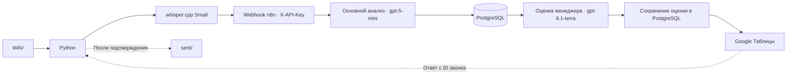
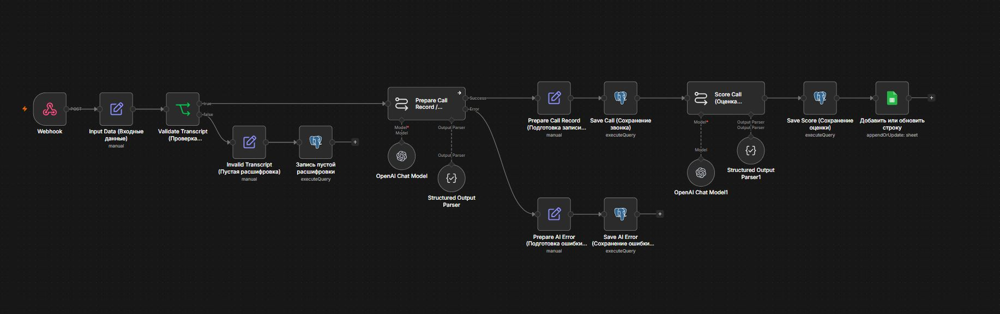
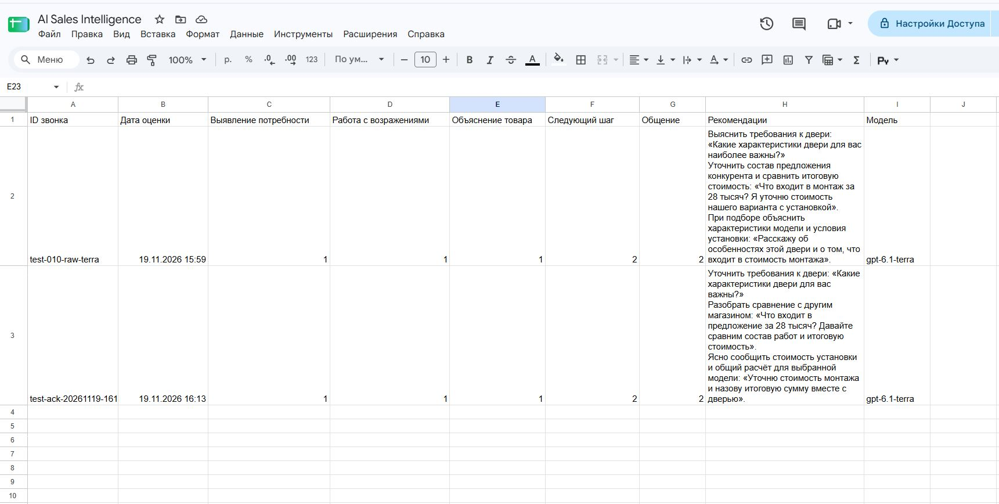

[English](README.md) | [Русский](README.ru.md)

# AI Sales Intelligence Platform

Демонстрационный процесс обработки звонков: локальная расшифровка WAV, структурированный анализ продаж, оценка менеджера, хранение в PostgreSQL и отчёт в Google Таблицах. Основа проекта: Python, whisper.cpp Small и n8n.

## Проблема бизнеса

Чтобы восстановить потребности клиента, бюджет, возражения и договорённости, записи звонков приходится просматривать вручную. Оценка работы менеджера требует отдельного разбора. Проект связывает расшифровку, извлечённые факты и оценку с обоснованиями по уникальному `call_id` и выводит краткий отчёт для проверки.

## Как работает решение

1. Python последовательно обрабатывает файлы `*.wav`, находящиеся в `incoming/` на момент запуска.
2. Локальный `whisper-cli.exe` использует многоязычную модель Small (`ggml-small.bin`), русский язык (`-l ru`), вывод TXT (`-otxt`) и CPU (`-ng`).
3. Python отправляет `call_id` (имя файла без расширения) и `transcript` в HTTPS Webhook n8n с заголовком `X-API-Key`.
4. n8n проверяет, что расшифровка не пустая. `gpt-5-mini` извлекает факты о продаже через парсер структурированного ответа, после чего PostgreSQL создаёт или обновляет запись звонка.
5. `gpt-6.1-terra` оценивает исходную расшифровку через второй парсер. PostgreSQL сохраняет оценку, затем Google Таблицы добавляют или обновляют строку по `ID звонка`.
6. Webhook отвечает после последнего узла. Python ждёт HTTP-ответ с тайм-аутом 180 секунд и проверяет, что получен JSON-объект, где `ID звонка` совпадает с именем WAV без расширения. Только после этого WAV и созданный `.wav.txt` перемещаются в `sent/`.

### Архитектура



Python запускает распознавание и передаёт текст; аудио остаётся локально. Текст расшифровки поступает в n8n и настроенному провайдеру моделей. PostgreSQL хранит записи. Google Таблицы служат демонстрационным реестром, а не полноценной CRM.

### Анализ и оценка

Анализ содержит `customer_need`, `budget_min`, `budget_max`, `purchase_timeline`, `objections`, `next_action` и `deal_status` (`interested`, `not_interested` или `unknown`). Для отсутствующих фактов инструкция модели требует `null`.

| Критерий | Что оценивается |
| --- | --- |
| `need_discovery` | Выявление требований, бюджета и сроков |
| `objection_handling` | Уточнение сомнений и содержательный ответ |
| `product_knowledge` | Полнота и ясность объяснения товара и условий покупки |
| `next_step` | Договорённость о следующем действии |
| `communication` | Ясность и вежливость, видимые в тексте |

Каждый критерий: `0` (не выполнено), `1` (частично), `2` (выполнено хорошо) или `null` (недостаточно данных). Промпт требует короткое обоснование с цитатой из расшифровки в соответствующем поле `*_reason` и до трёх рекомендаций именно по этому разговору с примерами реплик. Схема парсера допускает `null` в обоснованиях. При неясных ролях следует возвращать `null`; отдельного разделения говорящих в процессе нет. Интонация не оценивается, достоверность характеристик товара по базе знаний компании не проверяется.

PostgreSQL хранит `transcript`, `analysis`, `status`, `score`, `score_model` и `scored_at`, уникальный `call_id` и внутренний `id`. Обоснования и рекомендации находятся внутри JSONB-поля `score`. Сохранение оценки оставляет `status = 'analyzed'`; один статус не подтверждает наличие оценки или запись в Таблицы. В Google Таблицы передаются пять баллов, рекомендации, дата оценки и модель, без полей `*_reason`. Оценка `null` отображается как `Не оценено`, дата выводится в `Europe/Moscow`.

## Скриншоты процесса и отчёта

Реальные скриншоты, предоставленные вместе с проектом. Они показывают существующую демонстрацию, а не развёртывание очищенного шаблона с нуля.

### Процесс n8n



Основная ветка сохраняет анализ, оценивает звонок, сохраняет оценку и обновляет Таблицы. Отдельные ветки предусмотрены для пустой расшифровки и ошибки основного анализа. Наличие веток не означает, что все аварийные ситуации проверены.

### Отчёт Google Таблиц



Реестр содержит ID звонка, дату оценки, пять баллов, рекомендации и название модели. Скриншоты включены в исходном виде; видео нет.

## Пример входных данных и результата

Все файлы в `examples/` подготовлены вручную на синтетическом разговоре без персональных данных. Это иллюстрация формата, а не сохранённые ответы моделей и не подтверждение дополнительного прогона.

| Файл | Содержимое |
| --- | --- |
| [request.json](examples/request.json) | Тело запроса Webhook с русской расшифровкой без ручных меток ролей |
| [result.json](examples/result.json) | Пример полной строки `public.calls`: анализ, баллы и обоснования |
| [webhook-response.json](examples/webhook-response.json) | Пример результата последнего узла Таблиц и объекта HTTP-подтверждения |

На входе клиенту нужна входная дверь в квартиру, бюджет до 40 000, срок до двух недель. Клиент сравнивает предложение с установкой с предложением менеджера без установки. Иллюстративный анализ сохраняет верхнюю границу бюджета и договорённость о предложении сегодня. Баллы примера: `1 / 1 / 1 / 2 / 2`; рекомендации касаются требований, сравнения предложений и содержания обещанного расчёта. Реальный ответ модели может отличаться.

Строка базы данных не является HTTP-ответом. Python ожидает в ответе именно русское поле `ID звонка` со значением `demo-synthetic-001`. В примере ответа сохранён текущий разделитель рекомендаций из шаблона: буквальная последовательность `\n`.

## Подтверждённые сценарии

Ниже перечислены проверки, подтверждённые в существующей демонстрации со слов автора. При подготовке репозитория они повторно не запускались.

| Сценарий | Подтверждённый результат |
| --- | --- |
| Полная цепочка от WAV | Завершены распознавание, анализ, оценка, запись в PostgreSQL и Таблицы |
| Исходная расшифровка без ручных меток ролей | Выполнены анализ и оценка менеджера |
| Сохранение оценки | Сохранены баллы, обоснования и рекомендации |
| Повторный `call_id` | Обновлены существующая запись базы и строка Таблиц |
| Подтверждение Python | Получен совпадающий `ID звонка`, файлы перемещены в `sent/` |

Стабильная точность на разных разговорах и все аварийные сценарии **не проверены**. SQL очистки старой оценки при изменении текста добавлен, но отдельного теста этой логики не было. Импорт очищенного шаблона в новую установку n8n не проверялся.

## Установка и запуск

### 1. Локальные файлы

Нужны Windows с Python 3, работающий n8n с версиями узлов из шаблона, PostgreSQL, доступ провайдера к двум указанным моделям и аккаунт Google с правом редактировать отчёт. Точные версии n8n и whisper.cpp, использованные в демонстрации, не зафиксированы. Скрипт Python использует только стандартную библиотеку; установка через `pip` не требуется.

Из корня проекта в PowerShell создайте рабочие папки. Пример конфигурации копируется только при первой настройке; условие сохраняет существующий `.env`:

```powershell
New-Item -ItemType Directory -Force -Path incoming, sent | Out-Null
if (-not (Test-Path -LiteralPath .env)) {
    Copy-Item -LiteralPath .env.example -Destination .env
}
```

Локально замените заглушку тем же секретом, который задан в n8n. Текущий скрипт ожидает ровно одну строку без кавычек, комментариев и дополнительных переменных:

```dotenv
WEBHOOK_API_KEY=replace_with_your_webhook_key
```

Это общий секрет Webhook, а не ключ провайдера модели. Ключ провайдера, подключение к базе и доступ Google задаются в credentials n8n. Скрипт читает всё после первого `=`, полноценного dotenv-парсера в нём нет.

Возьмите подходящую сборку Windows из [официальных релизов whisper.cpp](https://github.com/ggml-org/whisper.cpp/releases) и многоязычную модель `small` по [официальной инструкции моделей](https://github.com/ggml-org/whisper.cpp/tree/master/models). Поместите `whisper-cli.exe`, **все DLL из той же сборки** и `ggml-small.bin` непосредственно в `Release/`, рядом с [transcribe.py](Release/transcribe.py). Англоязычная `small.en` для этой настройки не подходит. Эти локальные зависимости исключены из Git.

```text
AI-Sales/
  .env                       # только локально
  Release/
    transcribe.py
    whisper-cli.exe          # только локально
    whisper.dll              # только локально; набор DLL зависит от сборки
    ... other supplied DLLs  # остальные DLL той же сборки, только локально
    ggml-small.bin           # только локально
  incoming/                  # входные WAV, только локально
  sent/                      # подтверждённые WAV + .wav.txt, только локально
```

Используйте 16-битный PCM WAV; пример конвертации в [инструкции whisper.cpp](https://github.com/ggml-org/whisper.cpp#quick-start) использует моно, 16 кГц. Скрипт сам аудио не конвертирует. Для каждого нового звонка выбирайте отдельное имя файла: повтор имени означает повтор `call_id`.

### 2. PostgreSQL

Создайте базу и пользователя, затем выполните в этой базе [001_create_calls.sql](sql/001_create_calls.sql), например:

```powershell
psql -h localhost -p 5432 -U ai_sales_user -d ai_sales -f sql/001_create_calls.sql
```

Пользователю, выполняющему SQL, нужно право создания таблицы. Роли n8n нужны доступ к схеме, `SELECT`, `INSERT`, `UPDATE` для `public.calls` и доступ к её identity-последовательности. Если таблицу создаёт та же роль-владелец, соответствующие права на объекты уже есть. Для существующей таблицы требуется отдельное сравнение схемы: `IF NOT EXISTS` не добавляет отсутствующие столбцы. В `search_path` подключения должна входить схема `public`, поскольку аварийные ветки обращаются к `calls` без имени схемы.

### 3. Подключения n8n

Импортируйте [ai-sales-intelligence.template.json](workflows/ai-sales-intelligence.template.json). Шаблон неактивен, закреплённые данные пусты, ссылок на credentials нет. До включения процесса настройте подключения:

| Подключение | Настройка |
| --- | --- |
| `Webhook` | POST, путь `ai-sales/transcript`, credential Header Auth: имя заголовка `X-API-Key`, значение совпадает с секретом локального `.env` |
| `OpenAI Chat Model` | Credential провайдера с доступом к `gpt-5-mini`, основной анализ |
| `OpenAI Chat Model1` | Credential провайдера с доступом к `gpt-6.1-terra`, оценка менеджера |
| Все пять узлов Postgres | Одинаковые хост, порт, база, пользователь, пароль и подходящие настройки TLS; включая неподключённый узел просмотра `Execute a SQL query` |
| `Добавить или обновить строку` | Credential Google Таблиц, ID вашей таблицы и фактический лист |

Названия моделей выше взяты из поставляемого процесса; доступность зависит от провайдера и аккаунта. Если модель недоступна, именно эта конфигурация не запустится по инструкции. Настройка credentials описана в официальной документации [Postgres](https://docs.n8n.io/integrations/builtin/credentials/postgres/) и [Webhook](https://docs.n8n.io/integrations/builtin/core-nodes/n8n-nodes-base.webhook/).

Сохраните режим ответа Webhook **When Last Node Finishes** (`lastNode`) и **First Entry JSON**, чтобы получить один объект от последнего узла Таблиц. Немедленное подтверждение или массив не проходят проверку Python.

### 4. Google Таблицы

Создайте таблицу и лист `Звонки`. В первой строке, в столбцах A–I, задайте заголовки в точности:

```text
ID звонка | Дата оценки | Выявление потребности | Работа с возражениями | Объяснение товара | Следующий шаг | Общение | Рекомендации | Модель
```

Подключите в n8n credential Google Sheets OAuth2 аккаунта с правом редактирования этой таблицы. При собственной настройке OAuth включите Google Sheets API и Google Drive API, настройте экран согласия и OAuth-клиент типа Web, скопируйте точный redirect URI из n8n и завершите вход. Пошаговые действия приведены в [официальной инструкции Google OAuth2](https://docs.n8n.io/integrations/builtin/credentials/google/oauth-single-service/).

В узле Таблиц замените `REPLACE_WITH_SPREADSHEET_ID` на ID своего документа, заново выберите лист (его ID не обязательно `gid=0`) и при необходимости обновите метаданные столбцов. Сохраните **Append or Update Row**, поиск по **ID звонка** и все девять выражений сопоставления из шаблона. Не создавайте строки с дублирующимися ID вручную. Для рекомендаций удобно включить перенос текста в ячейках.

### 5. Осознанный запуск

В [transcribe.py](Release/transcribe.py) замените существующий фиксированный URL в `urllib.request.Request` на **Production URL** своего Webhook. В текущем `.env` настройки URL нет. Опубликуйте или активируйте процесс в соответствии с версией n8n; тайм-аут HTTP/прокси должен позволять завершить синхронную цепочку.

После настройки подключений положите разрешённый тестовый WAV в `incoming/` и запустите:

```powershell
python .\Release\transcribe.py
```

Эта команда выполняет реальную обработку и может привести к списаниям у провайдера моделей. При подготовке репозитория она **не запускалась**. Для текстовой проверки в собственной настроенной среде используйте `examples/request.json` как JSON-тело POST с `Content-Type: application/json` и `X-API-Key`; этот вариант пропускает распознавание и перенос файлов, но также вызывает модели.

## Ограничения

- Это демонстрационный процесс. Нет широкой оценки точности, гарантированного времени обработки и исчерпывающей проверки восстановления после ошибок. В расшифровке могут быть ошибки чисел, неясные роли и пропуски; перед кадровыми решениями оценки нужно проверять.
- Распознавание локальное, но текст передаётся в n8n и сервисы моделей. Данные звонков могут сохраняться в PostgreSQL и истории выполнений n8n. Публикуемые примеры синтетические; записи, реальные расшифровки, секреты, бинарные файлы Whisper и модели исключены.
- Скрипт выполняет один проход, не следит за папкой постоянно и не работает как служба. Язык, пути, файл модели, адрес Webhook и HTTP-тайм-аут 180 секунд заданы в коде. Чтение `.env` поддерживает только однострочный формат выше.
- Повтор `call_id` обновляет запись базы и строку Таблиц, но повторно вызывает анализ и оценку. Гарантии однократного выполнения нет. Обновления PostgreSQL и Таблиц не объединены в транзакцию; тайм-аут возможен уже после выполнения части работы сервером.
- При изменении расшифровки SQL основного upsert очищает `score`, `score_model` и `scored_at`; отдельного подтверждённого теста этой логики нет. Сохранение оценки дополнительно проверяет совпадение хранимой и оцениваемой расшифровок. Параллельные запросы и синхронизация устаревших строк Таблиц не проверены.
- Есть ветки пустой расшифровки и ошибки основного анализа. При конфликте они меняют только `status = 'error'`, поэтому прежний анализ и оценки могут сохраниться. Ветка ошибки ИИ также зависит от полей, поступивших из неуспешного узла. Для сбоев оценки, базы и Таблиц отдельное восстановление предусмотрено не везде.
- Python проверяет объект ответа и совпадение ID, а не каждое сохранённое поле. При неподтверждённом ответе файлы обычно остаются для разбора и повторного запуска, но два перемещения выполняются последовательно, без атомарности. Совпадения имён в `sent/` и прерванные перемещения требуют ручной проверки.
- Очищенный шаблон ещё не импортирован в новую установку n8n. До использования нужно проверить совместимость узлов, привязку credentials, форму финального ответа и сопоставление столбцов.

## Автор

Alexander Zaytsev
